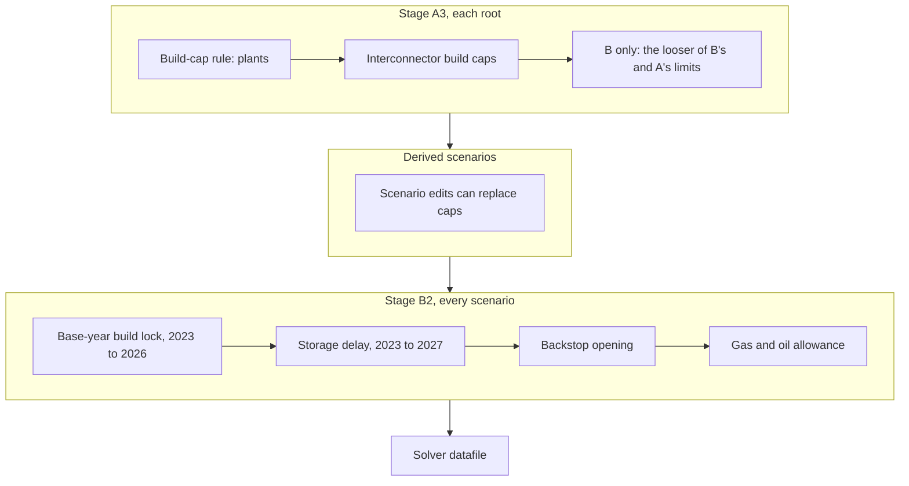
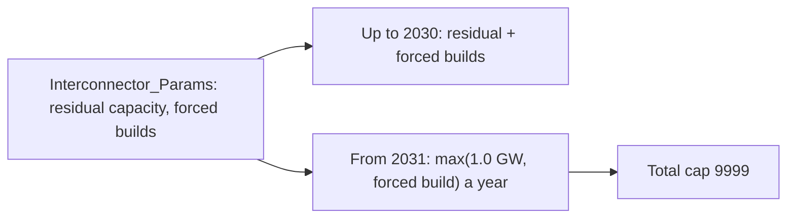

# Build limits

Each year the model chooses how much new capacity of each technology to build
in each node. Limits frame that choice: a build cap is the most new capacity
that may be built in a year (`TotalAnnualMaxCapacityInvestment`), a minimum
investment is the least (`TotalAnnualMinCapacityInvestment`), and a total
capacity cap limits residual plus new capacity in service
(`TotalAnnualMaxCapacity`). Between the limits, the model builds what costs
least. This chapter covers the steps that set build caps for plants, storage
and interconnectors. The internal grid has no build cap (see
[Internal grid expansion](internal-expansion.md)).



## The values 0, -1 and 9999

In the solver datafile, a build cap or total capacity cap of 0 allows nothing
in that year, 9999 allows up to 9999 GW (a finite cap), and -1 skips the
constraint. A row absent from the compiled files receives -1. The section "0, -1 and 9999" of the
[rules](../rules.md) page lists how each stage treats a 0 in the workbook.

## Build caps of plants

The rule `build_cap_rule.py` writes the build cap of every generation
technology that has residual capacity or a minimum investment in at least one
year. Its settings are in `config/scenarios/<root>/build_cap_rule.yaml`. It
runs in each root after the retirement rule, because it reads the
`ResidualCapacity` that retirement writes.

The rule computes each cap in five steps, in a fixed order:

1. **Formula.** The demand-scaled fleet of a node in a year is its residual
   capacity times the growth of its demand since 2024. The required growth is
   the increase of the demand-scaled fleet from the year before, or zero when it
   shrinks. Each technology's cap starts as:

   ```text
   cap = required growth x the technology's share of the node's 2024 fleet x margin_factor
   ```

2. **Cap multiplier.** The cap is multiplied by the value of
   `cap_multiplier_schedule` for the year, interpolated between the listed
   years.
3. **Family limits.** A family, the three letters after `PWR` in the name, takes
   the cap multiplier only up to its value in `family_limits`. A family limit of
   1.0 or less locks the family at its 2024 share. A family absent from the list
   takes the full cap multiplier.
4. **Technology top-up.** Any cap of an unlocked family below
   `technology_top_up_gw` is raised to that value.
5. **Adequacy top-up.** When the caps of a node add up to less than the
   adequacy share times its demand-scaled fleet, every cap of the node is
   multiplied by one factor so that the sum reaches that amount. The adequacy
   share is `adequacy_share_schedule`, interpolated between the listed years.

If a cap would be at or below the minimum investment of the same year, the rule
sets it to 1.01 times that minimum. The families in `exempt_prefixes`, the
storage families `PWRSDS` and `PWRLDS`, receive 9999 for both caps.
Interconnectors are skipped; their caps come from the next section.

### The released settings

| Key | `A_Calibrated_BAU` | `B_Optimised_VRE` | `C_Target_VRE` |
|---|---|---|---|
| `margin_factor` | 1.1 | 1.1 | 1.1 |
| `cap_multiplier_schedule` | 1.0 in 2023 and 2050 | 1.0 in 2023 and 2027, 3.0 in 2030, 6.0 in 2035, 10.0 in 2040, 15.0 in 2045, 25.0 in 2050 | 1.0 in 2023 and 2027, 1.1 in 2030, 1.3 in 2035, 1.5 in 2040, 2.0 in 2045, 3.0 in 2050 |
| `family_limits` | COA, PET, OIL, BIO, WAS 1.0 | COA, BIO, WAS 1.0; PET, OIL 1.01; NGS 1.2; URN 1.5; HYD, SHP 3.0 | COA, BIO, WAS 1.0; PET, OIL 1.01; NGS 1.2; URN 1.5 |
| `technology_top_up_gw` | 0.0 | 0.1 | 0.1 |
| `adequacy_share_schedule` | not set | 0.0 in 2040, 0.08 in 2045, 0.20 in 2050 | 0.0 in 2040, 0.08 in 2045, 0.20 in 2050 |
| `exempt_prefixes` | PWRSDS, PWRLDS | PWRSDS, PWRLDS | PWRSDS, PWRLDS |

In A the cap multiplier stays at 1.0, so the family limits only decide which
families are locked, and a top-up of 0.0 GW raises nothing. In B and C, solar
and wind have no family limit and take the full cap multiplier. In C, the VRE
target rule then replaces the solar and onshore wind caps with the capacity
envelope of `config/scenarios/C_Target_VRE/set_vre_targets.yaml`.

After its rules, `B_Optimised_VRE` takes, cell by cell, the larger of its own
build cap and that of `A_Calibrated_BAU` built in the same run, and the
smaller of the two minimum investments; the same holds for every other limit.
No limit of B is then tighter than A's, so B can reproduce A's plan and costs
no more. The [rules](../rules.md#b-as-a-relaxation-of-a) page gives the rule.

`margin_factor` 1.1 leaves 10 per cent to spare above each technology's share
of the required growth. It is a model margin and has no link to energy
security.

### Worked example of the adequacy share

The adequacy share between two listed years is a straight line. For 2047 in B
or C:

```text
adequacy share(2047) = 0.08 + (0.20 - 0.08) x (2047 - 2045) / (2050 - 2045) = 0.128
```

A node whose demand-scaled fleet is 50 GW in 2047 may then build at least
0.128 x 50 = 6.4 GW in total across its plants that year. If its five steps
gave caps that add up to 2 GW, each cap is multiplied by 6.4 / 2 = 3.2.

### Why the top-ups exist

The rule sets caps before the model runs, from the fleet in the input data.
That fleet counts only plants that already exist, so it grows more slowly as
plants retire, and late in the horizon the formula allows very little new
building even though demand still rises. With too little room, the model
would turn to the backstop, the very expensive technology `PWRBCK<node>`. The
technology top-up and the adequacy top-up give back that room. The adequacy
share is 0.0 until 2040, so the early years keep their formula caps. The caps
set the most that may be built; the model still chooses what it builds.

### Change a build cap setting

The tree shows where this section edits and where it checks.

```text
OSTRAM/
├── config/
│   └── scenarios/
│       └── <root>/ (A_Calibrated_BAU, B_Optimised_VRE or C_Target_VRE)
│           └── build_cap_rule.yaml         <- EDIT one value: the root and every derived scenario
└── workspace/
    └── execution/
        └── A2_Outputs_Params_otoole/
            └── B_Optimised_VRE/
                └── TotalAnnualMaxCapacityInvestment.csv
                                            <- CHECK the rows you expect to change
```

1. Edit one value in `config/scenarios/<root>/build_cap_rule.yaml`. A root's
   file changes the root and every scenario derived from it.
2. Build without solving, for example
   `python -m ostram run --skip-pull --compile-only --scenarios B_Optimised_VRE`.
3. Open
   `workspace/execution/A2_Outputs_Params_otoole/B_Optimised_VRE/TotalAnnualMaxCapacityInvestment.csv`
   and read the rows of the technologies you expect to change.

Some effects follow from the rule without a solve. An edit that lowers no cap
in any year cannot raise total system cost, because every choice the model had
is still open; an edit that raises no cap cannot lower it. In years where the
adequacy top-up applies, an edit to the margin factor, the cap multiplier, a
family limit or the technology top-up moves room between technologies and
leaves the node's total unchanged.

To change one technology in one derived scenario only, use a scenario edit on
`Secondary Techs` with `param: TotalAnnualMaxCapacityInvestment`, as the
[scenario edits](../scenario-edits.md) page describes.

## Build caps of interconnectors

Every interconnector value except the India-internal schedules and the two
rule settings of B and C comes from the sheet `Interconnector_Params` of the
scenario workbook, the one place to edit it:

- existing capacity is `ResidualCapacity`;
- forced builds are `TotalAnnualMinCapacityInvestment`: the committed projects
  in the `BAU` rows, which apply to support `BAU`, A and B, and the committed
  plus officially planned projects in the `C_Target_VRE` rows, which replace
  the `BAU` rows of their links for C and the scenarios derived from it.

The rule `relax_interconnectors.py` then sets the limits of the
interconnectors in each root, from `config/scenarios/<root>/relax_interconnectors.yaml`.

### A: existing plus committed

In `A_Calibrated_BAU` each of the 11 cross-border links is limited to its
existing capacity plus its committed projects. A's file sets
`cross_border_limit: existing_plus_committed` and has no cross-border
override, so the rule computes both limits from the workbook in every run:

1. the build cap, `TotalAnnualMaxCapacityInvestment`, is the larger of the
   link's residual capacity and that year's forced build, so no forced build
   is cleared;
2. the total cap, `TotalAnnualMaxCapacity`, is the residual capacity plus the
   forced builds still in service under the link's `OperationalLife`.

Worked example, India North to Nepal (`TRNINDNONPLXX`), with a residual
capacity of 0.5 GW and a forced build of 1.15 GW in 2028 (the New
Butwal-Gorakhpur and Nanpara-Kohalpur lines):

```text
build cap 2027: max(0.5, 0)    = 0.5 GW;  total cap 2027: 0.5 GW
build cap 2028: max(0.5, 1.15) = 1.15 GW; total cap 2028: 0.5 + 1.15 = 1.65 GW
build cap 2029: max(0.5, 0)    = 0.5 GW;  total cap 2029: 1.65 GW
```

The four India-internal corridors with project data keep their overrides in
A's file, as described below.

### B and C: lead time, then a build rate

`B_Optimised_VRE` and `C_Target_VRE` set
`cross_border_limit: lead_time_then_rate` with `lead_time_end_year: 2030` and
`build_rate_gw: 1.0`. Each is an ASSUMPTION stated with its source in the
YAML files and in [Interconnector build caps](../rules.md#interconnector-build-caps).
The rule computes the limits of nine cross-border links from the workbook in
every run:

1. up to and including 2030, both limits are A's: the build cap is the larger
   of the residual capacity and that year's forced build, and the total cap is
   the residual capacity plus the forced builds still in service;
2. from 2031, the build cap is the larger of 1.0 GW and that year's forced
   build, with no residual floor, and the total cap is 9999, a finite cap, so
   cost decides how large the link becomes.

The forced builds are the scenario's own, so C's planned projects count in C.



Worked example, Bangladesh to India East (`TRNBGDXXINDEA`), residual capacity
2.496 GW:

```text
B, 2027 to 2030: total cap 2.496 GW, build cap max(2.496, 0) = 2.496 GW
B, from 2031:    total cap 9999, build cap max(1.0, 0) = 1.0 GW a year
C, 2031:         build cap max(1.0, 2.0) = 2.0 GW, its forced build
```

In 2023 to 2026 the base-year build lock below replaces these build caps for
the links it covers.

A cross-border link may keep an override only when every value is 0. Two do,
Sri Lanka to the Maldives (`TRNLKAXXMDVXX`) and the Maldives to India South
(`TRNMDVXXINDSO`): they add no capacity and keep their residual capacity. A
non-zero cross-border override, a missing or non-numeric key, or either key
with `existing_plus_committed` stops the build.

From 2031 B's build cap of 1.0 GW is below A's on the three links whose
residual capacity is larger. The relaxation of B to A keeps it, because A's
total cap leaves A no room to build there beyond its forced builds; see
[B as a relaxation of A](../rules.md#b-as-a-relaxation-of-a).

### India-internal corridors with an override

`A_Calibrated_BAU`, `B_Optimised_VRE` and `C_Target_VRE` list the same four
India-internal corridors under `overrides`, with the same values. Each
override is a schedule of pipeline totals in GW: the corridor's existing
capacity plus the projects listed with commissioning dates by that year. The
rule:

1. interpolates the schedule linearly between the listed years and holds it at
   the first value before the first year and at the last value after the last
   year;
2. raises the value to the corridor's residual capacity where it is lower;
3. writes the result as the build cap, `TotalAnnualMaxCapacityInvestment`;
4. sets `TotalAnnualMaxCapacity` to 9999 in every year for each listed
   corridor with a positive value in some year, so cost decides how large the
   corridor becomes.

Each value is therefore the most new capacity the corridor may add in that
year, not its total size. A forced build above the build cap of its year would
be set to 0; every forced build of A, B and C fits within its cap.

### India-internal corridors without an override

The three India-internal corridors without an override, India East to India
West (`TRNINDEAINDWE`), India North-East to India North (`TRNINDNEINDNO`) and
India North to India West (`TRNINDNOINDWE`), take `headroom_factor` times their
residual capacity as their build cap: 1.0 in `A_Calibrated_BAU` and 1.5 in
`B_Optimised_VRE` and `C_Target_VRE`. The rule leaves their
`TotalAnnualMaxCapacity` as earlier stages wrote it.

ASSUMPTION (`docs/rules.md`, "Interconnector build caps"): in B and C, in every
year the base-year build lock does not cover, each India-internal corridor
with a schedule may add, in any one year, at most the corridor's pipeline
total for that year. National plans list announced projects, not physical
maxima, so the build cap sets how fast a corridor can grow, not how large it
becomes.

To change a forced build or an existing capacity, edit `Interconnector_Params`.
To change the lead time or the build rate of B or C, edit
`lead_time_end_year` or `build_rate_gw` in both files, or in one root's file to
change that root only. Check `TotalAnnualMaxCapacityInvestment.csv`,
`TotalAnnualMaxCapacity.csv` and `TotalAnnualMinCapacityInvestment.csv` after
a compile-only build. Derived scenarios can replace the caps with scenario
edits; `B_Opt_TxCap150` and `A_Calibrated_BAU_Clipped_TxFreeze2026` do so.
The cap of `B_Opt_TxCap150` holds India North to Nepal (`TRNINDNONPLXX`) at
0.75 GW (1.5 x 0.5 GW), so the committed 2028 build of 1.15 GW is lowered to
0.25 GW in that scenario.

## The base-year build lock

ASSUMPTION (`docs/rules.md`, "Base-year build lock"): no plant, storage or
interconnector adds capacity in 2023 to 2026 beyond the plants the workbook
lists for those years, because those years are history or under construction
and their builds are already known.

In stage B2, for every scenario, the lock sets the build cap of each locked
cell to the minimum investment that the model receives for the same cell, and
to 0 where there is none. It covers 2023 to 2026, every GENERATION technology
except the backstop `PWRBCK*`, the two STORAGE families and the
INTERCONNECTORS family of `config/scenarios/technology_types.csv`. Where a
scenario already holds a lower build cap, the lower value stays. The internal
grid, fuel supply and the backstop keep their own rules.

Two pre-solve checks run with the lock, and the B2 log lists their findings:

- **Activity floors.** A locked technology's annual activity lower limit that
  its locked fleet cannot generate is lowered to what that fleet can generate.
- **Trade floors.** Links that cannot carry a historical trade lower bound
  with their residual capacity and locked builds stay out of the lock in the
  lock years.

The settings are in `config/execution/Config_MOMF_T1_AB.yaml`:
`base_year_lock_active`, `base_year_lock_first_year` (2023) and
`base_year_lock_last_year` (2026).

## The storage delay

No new storage can be built before 2028: in stage B2 both caps of the
storage-linked technologies are set to 0 in the first five model years, 2023 to
2027, and to -1 afterwards. Existing storage is kept. The settings are in
`config/execution/Config_MOMF_T1_AB.yaml`: `storage_delay_active`,
`storage_delay_first_n_years` (5) and `storage_delay_storage_prefixes`. The
output file names keep the suffix `StorageDelayN5` whatever number is set,
because the suffix is the separate setting `storage_delay_suffix`.

## Backstop opening and the gas and oil allowance

B2 turns a cap of 0 into 9999 for both caps of `PWRBCK*`, so that a shortfall
shows as backstop use rather than an infeasible model.

Gas and oil plants that would otherwise be blocked may add up to 0.5 GW per
year in each node. B2 replaces a build cap of 0 or 9999 of `PWRPET*`,
`PWROIL*` and `PWRNGS*` with the value in
`inputs/execution/firm_capacity_fallbacks_by_cr.xlsx`, sheet `fallbacks`,
column `TotalAnnualMaxCapacityInvestment`, and a total capacity cap of 0 with
column `TotalAnnualMaxCapacity` (10 GW). It does not replace a build cap that
the base-year build lock holds. The switches are `reserve_margin_xlsx_active`,
`reserve_margin_xlsx_target_prefixes` and `reserve_margin_xlsx_sentinel_values`
in `config/execution/Config_MOMF_T1_AB.yaml`.

## Where to read the final caps

Read the caps the model receives in the solver datafile, under
the blocks that start `param default -1 : TotalAnnualMaxCapacityInvestment :=`
and `param default -1 : TotalAnnualMaxCapacity :=`.
The compiled CSV files show the values before the B2 steps above.
