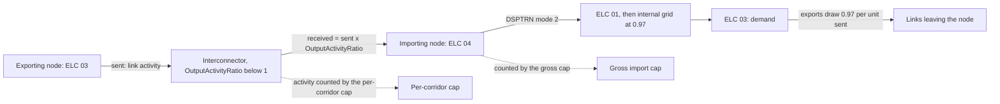

# Import caps

A scenario can limit imports in two ways. The gross import cap limits the
electricity a country receives from all its interconnectors together, as a
share of its demand. The per-corridor cap sets a yearly limit on the flow of
each listed interconnector. Both are written into the scenario's
`config/scenarios/<name>/scenario.yaml`, and neither needs a code change.

| | Gross import cap | Per-corridor cap |
|---|---|---|
| Example scenario | `B_Opt_Clipped_GrossImportCap15` | `B_Opt_TradeCap15` |
| Written as | a `gross_import_cap` block | an edit with `op: import_share_cap` |
| Limits | received imports of a country, all links together | the yearly activity of each listed link |
| Counts | energy received, after the link's loss | energy sent on the link, in both directions |
| Exports | not counted | use the same limit as imports on that link |
| Who chooses the corridors | the model, at least cost | the scenario, from a solved parent |
| Needs a solved parent | no | yes, in every run |
| Applied at | B2, in the solver datafile | A3, in the scenario's workbook |

Use the gross import cap to state a policy on a country's import share, such
as "imports cover at most 15 per cent of demand". Use the per-corridor cap to
hold each link to a fixed yearly amount, for example to keep the import pattern
of a reference run while lowering its level.

## How imports, exports and losses are counted



- **Imports** reach a node at `ELC<node>04`. The amount received is the energy
  sent times the link's `OutputActivityRatio`. For example, Bangladesh to India
  East delivers 0.98292 of the energy sent. Fourteen links take this ratio
  from `inputs/osemosys_global/OutputActivityRatio.csv`; four take 0.95 from
  the workbook sheet `Fixed_Horizon_Parameters`. The
  [rules](../rules.md#capacity-factor-and-losses) page gives the method and
  the ASSUMPTIONs.
- **Received imports then cross the node's internal grid**, through
  `DSPTRN<node>` mode 2 into `ELC<node>01`, and lose 3 per cent there, as the
  node's own thermal output does.
- **Exports** leave from the demand fuel `ELC<node>03`. A link that sends from a
  bus-bar node draws 0.97 of `ELC<node>03` per unit sent, because a published
  bus-bar requirement equals net generation plus imports minus exports and
  already holds the losses that export flows cause.
- **Transit** through a node is an import into it and an export out of it.

## The gross import cap

### The block

```yaml
gross_import_cap:
  countries: [BGD]
  fraction: 0.15
  first_year: 2027
  last_year: 2050
  note: "ASSUMPTION: test case, a 15 per cent share"
```

| Key | Rule |
|---|---|
| `countries` | Country codes from `BGD`, `BTN`, `IND`, `LKA`, `MDV` and `NPL`, each at most once. India is one country with its five regions. |
| `fraction` | The cap as a share of the country's yearly demand, from 0 to 1. One value for every listed country. |
| `first_year`, `last_year` | The first and last capped years, both included. |
| `note` | The basis of the cap. The reader ignores it. |

A repeated or unknown country code, a fraction outside 0 to 1 or a
`first_year` later than `last_year` stops the run. The released scenario
`B_Opt_Clipped_GrossImportCap15` caps all six countries at 0.15 from 2027 to
2050, with parent `B_Optimised_VRE`.

### What the model receives

When stage B2 writes the solver datafile, it reads the block and adds three
sets and one parameter:

| Datafile entry | Content |
|---|---|
| `set D4ImportCountry` | the listed countries |
| `set D4ImportDemand[<country>]` | the country's demand fuels: names that start with `ELC` and the code and end with `03` |
| `set D4ImportFlow[<country>]` | each (interconnector, fuel, mode) whose two country codes differ and whose output fuel starts with `ELC` and the code, with a positive `OutputActivityRatio` in the compiled `OutputActivityRatio.csv` |
| `param D4ImportFraction` | one value per country and capped year |

Links between India's regions have the same country code at both ends, so
they never count as imports for India. A flow from an Indian region into
another country counts for that country.

The model file `model/osemosys_fast_preprocessed.txt` holds the constraint
`D4_GrossImportCap`. For each capped country and year:

```text
sum over its flows and time slices of RateOfActivity x YearSplit x OutputActivityRatio
    <=  D4ImportFraction x sum over its demand fuels of SpecifiedAnnualDemand
```

The left side is the energy received, after the link's loss. Exports do not
appear in it.

### The division by (1 - loss)

The demand rows of a bus-bar country hold the published requirement x 0.97
(see [Internal grid expansion](internal-expansion.md)). So that the cap stays
the chosen share of the published requirement, B2 writes:

```text
D4ImportFraction = fraction / (1 - transmission_loss)     country whose demand rows are all bus-bar
D4ImportFraction = fraction                               country whose demand rows are all consumption (the Maldives)
```

A country with rows of both kinds stops the run.

Worked example, Bangladesh at 0.15 in 2027. The `Demand_Projection` row
`ELCBGDXX03` holds 431.644 PJ for 2027.

```text
D4ImportFraction        = 0.15 / 0.97                  = 0.154639 (to six digits)
SpecifiedAnnualDemand   = 431.644 x 0.97               = 418.69468 PJ
right-hand side         = 0.15 / 0.97 x 418.69468      = 64.7466 PJ
check                   = 0.15 x 431.644               = 64.7466 PJ
```

Bangladesh may receive at most 64.7466 PJ in 2027, 15 per cent of its
published requirement.

### Cap one country's gross imports

The tree shows where this section edits and where it checks.

```text
OSTRAM/
├── config/
│   ├── execution/
│   │   └── Config_MOMF_T1_AB.yaml
│   │       └── del_files                                 <- DO NOT EDIT: False keeps the LP file
│   ├── scenarios/
│   │   └── B_Opt_GrossImportCap20BGD/ (new-scenario copies it from B_Opt_Clipped)
│   │       └── scenario.yaml
│   │           ├── description                           <- EDIT rewrite it
│   │           └── gross_import_cap:                     <- EDIT add the block at the end
│   └── setups/
│       └── south_asia.yaml
│           └── decision_scenarios:                       <- EDIT add the scenario as the last line
└── workspace/
    └── execution/
        ├── A2_Outputs_Params_otoole/
        │   └── B_Opt_GrossImportCap20BGD/
        │       └── SpecifiedAnnualDemand.csv             <- CHECK row ELCBGDXX03 of the year
        └── Executables/
            └── B_Opt_GrossImportCap20BGD_0/
                ├── Pre_processed_<scenario>_0_StorageDelayN5_OpenBCK_RMCarefulXLSX.txt
                │                                         <- CHECK the D4Import lines
                └── Outputs/
                    ├── ProductionByTechnologyAnnual.csv  <- CHECK the four flows into ELCBGDXX04
                    └── Demand.csv                        <- CHECK FUEL ELCBGDXX03
```

This example caps Bangladesh at 20 per cent from 2027 to 2050. It copies
`B_Opt_Clipped`, which has the parent `B_Optimised_VRE`, the shared VRE
ceilings and no import cap.

1. **Copy the scenario folder.**

   ```powershell
   python -m ostram new-scenario B_Opt_GrossImportCap20BGD --from B_Opt_Clipped
   ```

   The command copies the folder and sets the `scenario` line to the new name.

2. **Edit `config/scenarios/B_Opt_GrossImportCap20BGD/scenario.yaml`.** Rewrite
   the `description`, and add this `gross_import_cap` block at the end of the
   file:

   ```yaml
   gross_import_cap:
     countries: [BGD]
     fraction: 0.20
     first_year: 2027
     last_year: 2050
     note: "ASSUMPTION: test case, a 20 per cent share"
   ```

   The lines `base_scenario: B_Optimised_VRE`, `apply_vre_ceiling_layer: true`
   and `edits: []` come with the copy. Keep them to compare with
   `B_Opt_Clipped`, which has the same parent and ceilings and no cap.

   If the file holds a key twice or a key the model does not know, the run
   stops before building and names the file, the key and the line.

3. **Register it.** Add `- B_Opt_GrossImportCap20BGD` as the last line of
   `decision_scenarios` in `config/setups/south_asia.yaml`. The run builds only
   registered scenarios, and the test `tests/regression/test_config_files.py`
   fails for a scenario folder that is not registered.

4. **Build without solving.**

   ```powershell
   python -m ostram run --skip-pull --compile-only --scenarios "B_Opt_Clipped,B_Opt_GrossImportCap20BGD"
   ```

5. **Check the written constraint.** Open the solver datafile
   `workspace/execution/Executables/B_Opt_GrossImportCap20BGD_0/Pre_processed_B_Opt_GrossImportCap20BGD_0_StorageDelayN5_OpenBCK_RMCarefulXLSX.txt`
   and search for `D4Import`. Expect:

   ```text
   set D4ImportCountry := BGD;
   set D4ImportDemand[BGD] := ELCBGDXX03;
   set D4ImportFlow[BGD] := (TRNBGDXXINDEA,ELCBGDXX04,2) (TRNBGDXXINDNE,ELCBGDXX04,2) (TRNBTNXXBGDXX,ELCBGDXX04,1) (TRNNPLXXBGDXX,ELCBGDXX04,1);
   param D4ImportFraction :=
   BGD 2027 0.206186
   ...
   ```

   There is one `D4ImportFraction` line per year from 2027 to 2050, each
   0.20 / 0.97, which the datafile writes to 17 significant digits; the first
   six are shown here. The right-hand side for a year is that value times the
   year's `ELCBGDXX03` row of `SpecifiedAnnualDemand.csv` in
   `workspace/execution/A2_Outputs_Params_otoole/B_Opt_GrossImportCap20BGD/`;
   for 2027 it is 0.20 / 0.97 x 418.69468 = 86.3288 PJ. An empty
   `set D4ImportCountry := ;` means the file has no `gross_import_cap` block.
   The compiled CSV files of the new scenario equal those of `B_Opt_Clipped`,
   because the cap lives only in the datafile.

6. **Solve.**

   ```powershell
   python -m ostram run --skip-pull --scenarios B_Opt_GrossImportCap20BGD
   ```

   The run writes an LP file beside the datafile (`..._output.lp`) and keeps
   it unless `del_files` in `config/execution/Config_MOMF_T1_AB.yaml` is
   `True`. The row `D4_GrossImportCap(GLOBAL,BGD,2027):` holds the same
   right-hand side after its `<=` sign.

7. **Check the import share from the outputs.** In
   `workspace/execution/Executables/B_Opt_GrossImportCap20BGD_0/Outputs/`:
   - received imports of a year = the sum of `ProductionByTechnologyAnnual.csv`
     over the four flows listed in `D4ImportFlow[BGD]`, rows with `FUEL`
     `ELCBGDXX04`;
   - published requirement of the year = the sum of `Demand.csv` over the time
     slices for `FUEL` `ELCBGDXX03`, divided by 0.97;
   - import share = received imports / published requirement. It is at most
     0.20 in every capped year, and equal to 0.20 where the cap binds.

### Cap another node

The tree shows where this section edits and where it checks.

```text
OSTRAM/
└── config/
    └── scenarios/
        └── <name>/
            └── scenario.yaml
                ├── edits:                  <- EDIT for one Indian region, a per-corridor cap
                └── gross_import_cap:
                    └── countries:          <- EDIT list the country codes
```

- **Another country**: list its code in `countries`. Several countries can
  share one block and one fraction. Bhutan, Nepal and Sri Lanka are bus-bar
  countries, so their fraction is divided by 0.97; the Maldives keeps the
  fraction as written.
- **India**: `IND` caps the five regions together, against their summed
  demand, and counts only flows from outside India.
- **One Indian region**: the gross cap accepts only country codes. Use the
  per-corridor cap below with that region as `importer`.
- **A different share per country**: one block has one fraction. Use a
  per-corridor cap for the second country.

## The per-corridor cap

### The edit

`B_Opt_TradeCap15` holds this edit, with parent `B_Optimised_VRE`:

```yaml
- sheet: Secondary Techs
  techs: [TRNBGDXXINDEA, TRNBGDXXINDNE, TRNBTNXXBGDXX, TRNNPLXXBGDXX]
  param: TotalTechnologyAnnualActivityUpperLimit
  op: import_share_cap
  result: B_Optimised_VRE
  share: 0.15
  demand_fuel: ELCBGDXX03
  importer: BGDXX
  years: [2027, 2028, ..., 2050]
```

For each listed link and year, the edit writes:

```text
limit(link, y) = share x parent demand of demand_fuel in y / (1 - loss)
                 x parent production of the link into the importer's fuels in y
                 / parent production of all listed links into the importer's fuels in y
```

The division by (1 - loss) applies when `demand_fuel` is a bus-bar row, so the
limits add up to `share` of the published requirement. A year in which the
parent imports nothing gives every listed link a limit of 0.

The value goes into `TotalTechnologyAnnualActivityUpperLimit`, the yearly
activity of the link over both of its modes, measured as energy sent. So the
limit:

- counts exports on the same link against the same amount;
- counts energy before the link's loss, so the energy received is lower;
- fixes the split between links to the parent's split; the model cannot move
  imports from one link to another.

`B_Opt_TradeCap15` also sets the activity of `TRNNLIBGDXX` and `TRNRPOBGDXX` to
zero from 2027, as its description says.

### The solved parent

The edit reads `Demand.csv` and `ProductionByTechnologyAnnual.csv` of the
parent, solved in the same run, from `Executables/<parent>_0/Outputs/` under
the execution workspace. A new scenario that uses the edit needs an entry
under `derived_dependencies` in `config/setups/south_asia.yaml`, as
`B_Opt_TradeCap15` has:

```yaml
derived_dependencies:
  B_Opt_TradeCap15:
  - type: result
    scenario: B_Optimised_VRE
    environment: OSTRAM_B_OPTIMISED_VRE_RESULT
    default_path: Executables/B_Optimised_VRE_0
```

Solve the parent first, or point the environment variable at a folder that
holds its result. The run stops before A3 when the folder is missing. The
[scenario edits](../scenario-edits.md#edits-that-read-a-solved-parent) page
describes the rule.

### Check a per-corridor cap

The tree shows where this section edits and where it checks.

```text
OSTRAM/
├── config/
│   └── scenarios/
│       └── B_Opt_TradeCap15/
│           └── scenario.yaml
│               └── edits:                    <- EDIT the edit in "The edit"
└── workspace/
    ├── preparation/
    │   └── A1_Outputs/
    │       └── A1_Outputs_<scenario>/
    │           └── apply_patches_CHANGES_<stamp>.json
    │                                         <- CHECK the limits
    └── execution/
        ├── A2_Outputs_Params_otoole/
        │   └── <scenario>/
        │       └── TotalTechnologyAnnualActivityUpperLimit.csv
        │                                     <- CHECK the limits
        └── Executables/
            └── <scenario>_0/
                ├── Pre_processed_<scenario>_0_StorageDelayN5_OpenBCK_RMCarefulXLSX.txt
                │                             <- CHECK block TotalTechnologyAnnualActivityUpperLimit
                └── Outputs/
                    └── TotalTechnologyAnnualActivity.csv
                                              <- CHECK at most the limit
```

The limits appear in the edit log, in
`workspace/execution/A2_Outputs_Params_otoole/<scenario>/TotalTechnologyAnnualActivityUpperLimit.csv`,
and in the solver datafile in the block that starts
`param default -1 : TotalTechnologyAnnualActivityUpperLimit :=`.
After the solve, the link's yearly activity in
`TotalTechnologyAnnualActivity.csv` is at most its limit.

## Imports into Nepal from India

Every root except `BAU`, and so every derived scenario, already holds one
import limit of its own: the setup policy `link_import_cap` in
`config/setups/south_asia.yaml`. From 2027, the yearly flow from India to
Nepal on each of `TRNINDEANPLXX` and `TRNINDNONPLXX` is at most what the link's
residual capacity carries (constraint `D4_LinkImportCap`). The policy's
ASSUMPTION and source are in the comment lines above it. Keep it in mind when
you cap Nepal: the two limits apply together.
