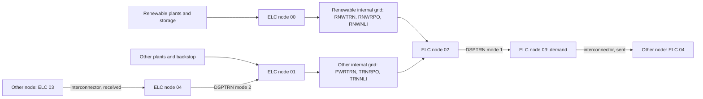
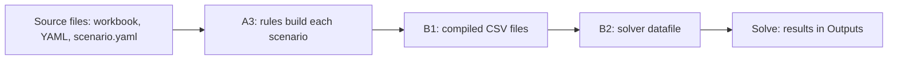

# User guide: transmission, import caps and build caps

This guide answers four questions about the South Asia model of OSTRAM:

1. How do you change the capital and operating costs of the grid inside each
   node and of the interconnectors between nodes?
2. What sets the expansion of each node's internal grid, and how does it
   follow new generation and demand?
3. How do you limit the share of a country's demand that imports may cover,
   and how are imports, exports and losses counted?
4. What limits how much new capacity the model may build each year?

It is written for a modeller who has the repository installed, as the
[installation](../installation.md) and [quickstart](../quickstart.md) pages
describe, and who can run a compile-only build. Every statement describes the
files and code of the release. Terms follow the [glossary](../glossary.md).

## The model in one picture

The model has ten nodes, also called country-regions: Bangladesh (`BGDXX`),
Bhutan (`BTNXX`), five regions of India (`INDEA`, `INDNE`, `INDNO`, `INDSO`,
`INDWE`), Sri Lanka (`LKAXX`), the Maldives (`MDVXX`) and Nepal (`NPLXX`). A
technology or fuel name ends with the node it belongs to, for example
`RNWTRNBGDXX` or `ELCBGDXX03`.

Inside each node, electricity moves through five fuels and seven
technologies. Plants deliver to one of two collection fuels. Six internal
transmission technologies, the internal grid, carry it to a common fuel, and
the dispatch technology `DSPTRN<node>` passes it to the demand fuel. The
interconnectors, 18 technologies named `TRN` followed by two nodes, link the
demand fuel of one node with the import fuel of another.

The fuels are:

| Fuel | What it holds |
|---|---|
| `ELC<node>00` | Output of renewable plants (biomass, hydro, solar thermal, geothermal, solar, waste, onshore and offshore wind) and of storage. |
| `ELC<node>01` | Output of the other plants, including small hydro and the backstop `PWRBCK<node>`, and imports delivered by `DSPTRN<node>` mode 2. |
| `ELC<node>02` | Output of the six internal grid technologies. |
| `ELC<node>03` | The demand fuel. `SpecifiedAnnualDemand` sits here, and interconnectors that send from this node take their input here. |
| `ELC<node>04` | Electricity received by the node's interconnectors, before it enters the node. |

The renewable list is `renewable_fuels` in
`config/preparation/Config_country_codes.yaml`. Small hydro (`SHP`) is not in
it, so small hydro plants deliver to `ELC<node>01`.

## How a value reaches the model

Every value in this guide passes through the same chain. You edit a source
file; the pipeline builds each scenario's workbooks in stage A3, compiles them
into CSV files in stage B1, and writes the solver datafile in stage B2. A
change is confirmed when it appears in the compiled CSV files and in the
solver datafile, not when it appears in the source file.

The places you will open are, under the workspace folder `workspace/`:

| What | Where |
|---|---|
| Compiled parameters of a scenario | `execution/A2_Outputs_Params_otoole/<scenario>/<Parameter>.csv` |
| The solver datafile | `execution/Executables/<scenario>_0/Pre_processed_<scenario>_0_StorageDelayN5_OpenBCK_RMCarefulXLSX.txt` |
| Results of a solved scenario | `execution/Executables/<scenario>_0/Outputs/<Variable>.csv` |
| The edit log of a derived scenario | `preparation/A1_Outputs/A1_Outputs_<scenario>/apply_patches_CHANGES_<stamp>.json` |

## Units

Capacity is in GW and energy in PJ. A capital cost in USD per kW equals the
model's million USD per GW, so the numbers carry over unchanged. One GW running
for a whole year gives 31.536 PJ, the `CapacityToActivityUnit` of every
transmission technology. One GWh is 0.0036 PJ.

## How to read the rest

Each chapter stands alone.

- [Transmission costs](transmission-costs.md) answers question 1.
- [Internal grid expansion](internal-expansion.md) answers question 2.
- [Import caps](import-caps.md) answers question 3.
- [Build limits](build-limits.md) answers question 4.
- [Checking a run](checking-a-run.md) lists the checks that confirm a scenario
  did what you meant.
- [Known limitations](known-limitations.md) lists what the model does not
  represent, and what you can do about each item.

Commands are written for the activated conda environment, run from the
repository root. A line such as
`python -m ostram run --skip-pull --compile-only --scenarios <name>` builds a
scenario up to its solver datafile without solving it.
