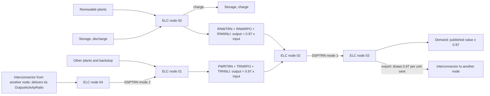

# Internal grid expansion

The internal grid of a node has no expansion rule and no fixed ratio to plant
capacity or to demand. Each internal grid technology is a technology like any
other: it has a capacity, its flow in each time slice cannot exceed that
capacity, and new capacity costs money. The optimisation adds internal grid
capacity in the years and amounts that serve demand at least total cost. What
a rule does set is the grid that exists in the base year, 2023.

## The six internal families

| Family | Carries | From fuel | To fuel | Base-year capacity |
|---|---|---|---|---|
| `RNWTRN<node>` | renewable plant and storage output, existing lines | `ELC<node>00` | `ELC<node>02` | computed every run |
| `RNWRPO<node>` | the same, repowered lines | `ELC<node>00` | `ELC<node>02` | 0 |
| `RNWNLI<node>` | the same, new lines | `ELC<node>00` | `ELC<node>02` | 0 |
| `PWRTRN<node>` | other plant output and imports, existing lines | `ELC<node>01` | `ELC<node>02` | computed every run |
| `TRNRPO<node>` | the same, repowered lines | `ELC<node>01` | `ELC<node>02` | 0 |
| `TRNNLI<node>` | the same, new lines | `ELC<node>01` | `ELC<node>02` | 0 |

Within a group of three, the technologies have the same cost, the same life
and the same loss; only the existing line starts with capacity. The model may
therefore build new capacity on any of the three at the same cost, and the
split between them carries no meaning. Read the grid of a node as the sum of
the three renewable families and the sum of the three other families.

The dispatch technology `DSPTRN<node>` has 9999 GW of residual capacity and no
cost, so it never limits a flow. Mode 1 takes `ELC<node>02` to the demand fuel
`ELC<node>03`. Mode 2 takes received imports from `ELC<node>04` to
`ELC<node>01`.

## One node, from plants to demand



Imports therefore cross the receiving node's other-plant grid and pay its
loss, as the node's own thermal output does. Exports leave from the demand
fuel and do not use the sending node's grid a second time.

## How generation and demand drive new grid capacity

Two standard OSeMOSYS equations link the internal grid to plants and demand.
Both hold in every time slice and year.

The capacity limit (`CAa4_Constraint_Capacity` in
`model/osemosys_fast_preprocessed.txt`), for each internal grid technology:

```text
sum over modes of RateOfActivity  <=  (ResidualCapacity + NewCapacity still in service)
                                      x CapacityFactor x CapacityToActivityUnit
```

`CapacityToActivityUnit` is 31.536 PJ per GW-year. No `CapacityFactor` is
written for the internal grid, so it takes the datafile default of 1.

The energy balance (`EBa11_EnergyBalanceEachTS5`), for each fuel: what the
technologies produce must cover the demand of the fuel plus what other
technologies use. Applied to the fuels of one node, it gives this chain, in
energy per time slice:

```text
ELC00:  renewable output + storage discharge    >=  renewable grid input + storage charge
ELC01:  other plant output + received imports   >=  other grid input
ELC02:  0.97 x (renewable grid input + other grid input)  >=  DSPTRN mode 1
ELC03:  DSPTRN mode 1   >=  demand + 0.97 x energy sent on interconnectors
```

The 0.97 is 1 minus `transmission_loss`. The last line holds for every node
except the Maldives, whose interconnectors draw 1 per unit sent, because its
demand is measured at consumption.

Read together, the two equations say:

- **New plants.** Each new plant adds output to `ELC<node>00` or
  `ELC<node>01`, and that output reaches demand only through the grid of its
  side. When the flow in the busiest time slice exceeds the grid capacity in
  service, the model must add grid capacity or not use the output in that
  slice.
- **Demand.** Higher demand in a time slice needs more flow through the grid
  in that slice, from domestic plants or imports. Imports enter at
  `ELC<node>01`, so they load the other-plant grid too.
- **The busiest time slice decides.** Capacity is sized to the highest flow
  rate over the time slices of a year, not to the yearly energy. A plant that
  produces mostly outside that slice adds energy but little need for grid.
- **Cost.** Each GW of new grid adds its capital cost and fixed cost, as set in
  [Transmission costs](transmission-costs.md), to the total cost. The model
  weighs that cost against the alternatives that would avoid it, such as
  imports, storage or plants with a different output profile.
- **No build cap.** No build cap and no total capacity cap is written for the
  six families. The base-year build lock and the build-cap rule leave them
  out. Only cost and the flow limit decide how much is built.

The scenario `B_Opt_TradeCap15` is the one released case that changes this: it
sets the activity of `TRNNLIBGDXX` and `TRNRPOBGDXX` to zero from 2027 through
`TotalTechnologyAnnualActivityUpperLimit`, so that Bangladesh's other-plant
grid can grow only on `PWRTRNBGDXX`.

## The loss inside a node

`transmission_loss`, 0.03, in the `internal_transmission` block of
`config/preparation/Config_country_codes.yaml` sets three things in every root
(rule `apply_internal_tx_losses.py`):

1. The `OutputActivityRatio` of the six internal families is 1 - 0.03 = 0.97.
2. Each demand row marked `bus-bar` in the `Measured_at` column of the
   workbook sheet `Demand_Projection` is written to `SpecifiedAnnualDemand` as
   its workbook value x 0.97, in every year. A published bus-bar requirement
   already includes the grid's losses; the plants and imports that reach it
   through the grid at 0.97 then supply the published requirement. The
   Maldives row is marked `consumption` and keeps its workbook value.
3. Each interconnector mode that sends from a bus-bar node draws 0.97 of
   `ELC<node>03` per unit sent (`InputActivityRatio`).

ASSUMPTION (in the YAML file): a transmission-only loss of 3 per cent inside
each node, uniform across nodes.

Worked example, Bangladesh 2023: the `Demand_Projection` row `ELCBGDXX03` holds
332.003 PJ. The model's `SpecifiedAnnualDemand` is 332.003 x 0.97 = 322.04291
PJ. The plants and imports must deliver 322.04291 / 0.97 = 332.003 PJ into the
grid, the published requirement.

A blank or unknown `Measured_at` value stops the run.

## The base-year grid

The rule `apply_internal_transmission.py` computes, in every run and for
every root, the 2023 `ResidualCapacity` of `RNWTRN<node>` and `PWRTRN<node>`
for each node. It reads the scenario's workbooks after the base-year values
are written, so it uses the values the model compiles. The other four
families start at 0. A derived scenario keeps its root's values.

Inputs, all for 2023: `SpecifiedAnnualDemand` and `SpecifiedDemandProfile` of
`ELC<node>03`, `YearSplit`, and the `CapacityFactor` and `ResidualCapacity` of
the node's plants. The demand of a bus-bar row is first divided by 0.97, so the
rule works with the published requirement.

```text
peak(ts)   = demand x SpecifiedDemandProfile(ts) / (YearSplit(ts) x 8760 h)       GW, for each time slice ts
peak       = the largest peak(ts); its time slice is the peak slice
RE at peak = sum over renewable plants of ResidualCapacity x CapacityFactor(peak slice)
RNWTRN     = m x RE at peak
PWRTRN     = m x peak - RNWTRN
```

When `PWRTRN` would be negative, `RNWTRN` = m x peak and `PWRTRN` = 0. The
demand is in PJ and is turned into GWh with 1 PJ = 1e6 / 3600 GWh before the
division by hours.

ASSUMPTIONs, each stated in `docs/rules.md` and in the YAML file:

- `m` is `residual_peak_margin`, 1.2: the 2023 internal grid of a node carries
  1.2 times its 2023 peak time-slice demand, a margin above the peak for the
  spread of load inside the node.
- Renewable plants are `BIO`, `GEO`, `WAS`, `HYD`, `SPV`, `WON`, `WOF` and
  `CSP`. Biomass, geothermal and waste count at capacity factor 1, because
  they are dispatchable.
- Small hydro (`SHP`) counts as non-renewable.
- A renewable plant with no capacity factor in the peak slice counts at the
  mean of its 2023 capacity factors in the other slices, or 1 when it has none.

A missing demand, demand profile, year split or `m` stops the run with an
error that names the node and the input.

Worked example, Bangladesh, from the compiled 2023 inputs of
`A_Calibrated_BAU`: the peak time slice is `S3D4`, with a peak of 12.4255 GW,
and the renewable plants give 0.19275 GW at that slice.

```text
RNWTRNBGDXX = 1.2 x 0.19275             = 0.2313 GW
PWRTRNBGDXX = 1.2 x 12.4255 - 0.2313    = 14.6793 GW
```

In Bhutan the renewable capacity at peak is larger than the peak, so
`RNWTRNBTNXX` is 1.2 times the peak and `PWRTRNBTNXX` is 0.

### Check the base-year grid of a node

The tree shows where this section reads.

```text
OSTRAM/
└── workspace/
    └── execution/
        └── A2_Outputs_Params_otoole/
            └── <scenario>/
                ├── ResidualCapacity.csv        <- CHECK 2023 rows of RNWTRN<node>, PWRTRN<node>
                ├── SpecifiedAnnualDemand.csv   <- CHECK input to recompute them
                ├── SpecifiedDemandProfile.csv  <- CHECK input to recompute them
                ├── YearSplit.csv               <- CHECK input to recompute them
                └── CapacityFactor.csv          <- CHECK input to recompute them
```

After a compile-only build, open
`workspace/execution/A2_Outputs_Params_otoole/<scenario>/ResidualCapacity.csv`
and read the 2023 rows of `RNWTRN<node>` and `PWRTRN<node>`. To recompute
them, take from the same folder `SpecifiedAnnualDemand.csv`,
`SpecifiedDemandProfile.csv`, `YearSplit.csv`, `CapacityFactor.csv` and the
2023 `ResidualCapacity` of the node's plants, and apply the formula above.

### Change the base-year grid

The tree shows where this section edits and where it checks.

```text
OSTRAM/
├── config/
│   └── preparation/
│       └── Config_country_codes.yaml
│           └── internal_transmission:
│               └── residual_peak_margin        <- EDIT the margin of the base-year grid
└── workspace/
    └── execution/
        └── A2_Outputs_Params_otoole/
            └── <scenario>/
                └── ResidualCapacity.csv        <- CHECK 2023 rows of RNWTRN<node>, PWRTRN<node>
```

Change `residual_peak_margin` in the `internal_transmission` block. The
residuals of every node scale with it. No file holds the residuals
themselves; they follow the inputs in every run.
