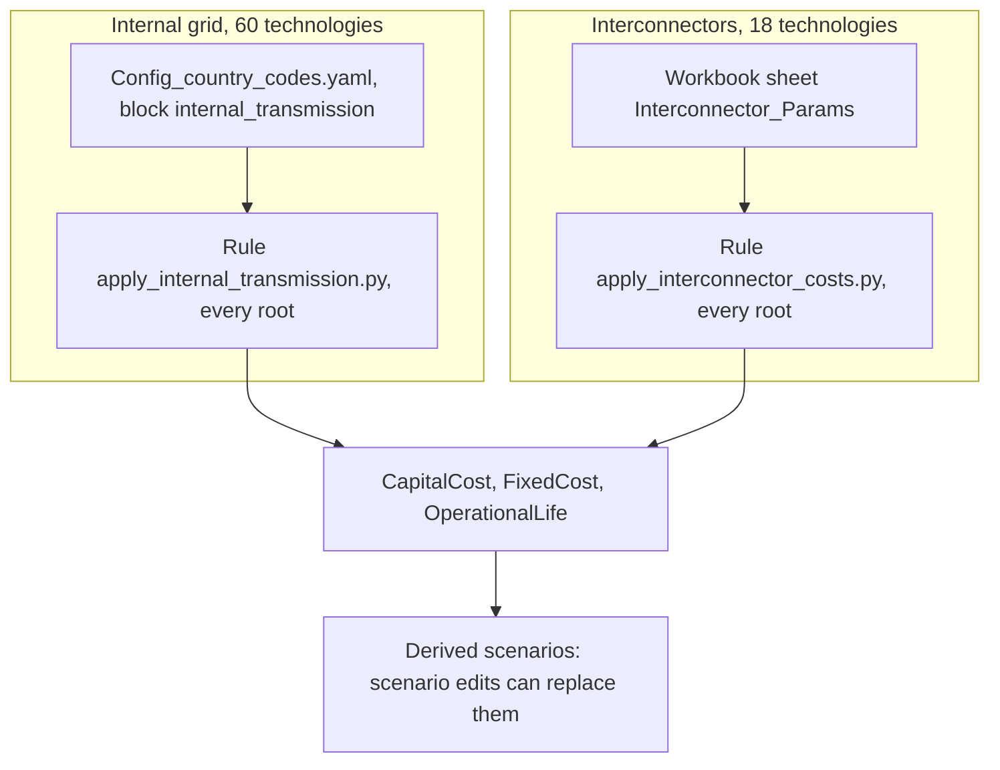

# Transmission costs

The model has two kinds of transmission, and their costs live in different
files. The internal grid of each node is six technologies whose costs a rule
computes in every run from a short block of sourced inputs. The 18
interconnectors take their costs from one sheet of the scenario workbook.



Both rules run in stage A3 for every root scenario (`BAU`, `A_Calibrated_BAU`,
`B_Optimised_VRE` and `C_Target_VRE`), after the rules that the Control sheet
names. A derived scenario starts from its root's values and can change them
with scenario edits.

## Internal grid costs

### Where internal grid costs are set

The six internal grid families are `RNWTRN`, `RNWRPO` and `RNWNLI`, which carry
renewable output, and `PWRTRN`, `TRNRPO` and `TRNNLI`, which carry the output of
the other plants and imports. Each family has one technology per node, 60 in
all. Their costs are set by the block `internal_transmission` of
`config/preparation/Config_country_codes.yaml`.

| Key | Released value | What it is |
|---|---|---|
| `esmap_capital_cost_usd2010_per_kw` | 96 | Capital cost of a South Asia 400 kV line, USD2010 per kW. |
| `muv_2010`, `muv_2022`, `muv_2023` | 100, 117.5, 114.1 | World Bank MUV index, used to move prices between years. |
| `fixed_cost_share` | 0.03 | Share of the capital cost paid each year as fixed operation and maintenance. |
| `gec2_cost_rs_crore` | 12031.33 | Cost of India's Green Energy Corridor Phase II, rupees crore. |
| `gec2_capacity_mw` | 19431 | Renewable capacity that Phase II connects, MW. |
| `inr_per_usd_2022` | 78.5792 | Rupees per US dollar, 2022 average. |
| `operational_life` | 40 | Life of all six families, years. |
| `transmission_loss` | 0.03 | Loss inside each node (see [Internal grid expansion](internal-expansion.md)). |
| `residual_peak_margin` | 1.2 | Margin of the base-year grid (see [Internal grid expansion](internal-expansion.md)). |

Each key carries its source, a URL, in the comment lines above it. The
[rules](../rules.md#internal-transmission-residuals) page repeats the sources
in a table.

The same file also holds blocks named `RNWTRN:`, `PWRTRN:` and so on, with
values such as `CapitalCost: 100`. Stage A2 writes those values first, and the
rule replaces them. Do not edit those blocks to change a cost: the rule
overwrites the result.

### The internal grid cost formula

The rule `apply_internal_transmission.py` computes four numbers in every run.
They are the same in every node and every year.

```text
base capital cost    = esmap_capital_cost_usd2010_per_kw x muv_2023 / muv_2010
base fixed cost      = fixed_cost_share x base capital cost
renewable add-on     = gec2_cost_rs_crore x 1e7 / (gec2_capacity_mw x 1e3)
                       / inr_per_usd_2022 x muv_2023 / muv_2022
renewable multiplier = (base capital cost + renewable add-on) / base capital cost
```

The factor 1e7 turns crore into rupees, and 1e3 turns MW into kW. The
non-renewable families `PWRTRN`, `TRNRPO` and `TRNNLI` take the base capital and
fixed costs. The renewable families `RNWTRN`, `RNWRPO` and `RNWNLI` take both
costs times the renewable multiplier. All six take `operational_life`.

ASSUMPTION (in the YAML file): one ESMAP value, a 400 kV line over 250 km,
serves every node. ASSUMPTION (in the YAML file): renewable plants pay the
average Green Energy Corridor Phase II connection cost on top of the shared
grid cost, in every node.

### Worked example with the released inputs

```text
base capital cost    = 96 x 114.1 / 100                                = 109.536 USD2023 per kW
base fixed cost      = 0.03 x 109.536                                  = 3.28608 USD2023 per kW per year
renewable add-on     = 12031.33 x 1e7 / (19431 x 1e3) / 78.5792
                       x 114.1 / 117.5                                 = 76.517 USD2023 per kW
renewable multiplier = (109.536 + 76.517) / 109.536                    = 1.6986
renewable capital    = 109.536 x 1.6986                                = 186.053 USD2023 per kW
renewable fixed      = 3.28608 x 1.6986                                = 5.582 USD2023 per kW per year
```

The compiled files write each value rounded to four decimals. So the model
receives, for every node and year:

| Technology | `CapitalCost` | `FixedCost` | `OperationalLife` |
|---|---|---|---|
| `PWRTRN<node>`, `TRNRPO<node>`, `TRNNLI<node>` | 109.536 | 3.2861 | 40 |
| `RNWTRN<node>`, `RNWRPO<node>`, `RNWNLI<node>` | 186.0531 | 5.5816 | 40 |

The rule writes `CapitalCost` and `FixedCost` on the `Demand Techs` sheet of
the scenario's `A-O_Parametrization.xlsx` and `OperationalLife` on its
`Fixed Horizon Parameters` sheet.

### Change the internal grid cost for every scenario

The tree shows where this section edits and where it checks.

```text
OSTRAM/
├── config/
│   └── preparation/
│       └── Config_country_codes.yaml
│           ├── RNWTRN:, RNWRPO:, RNWNLI:,
│           │   PWRTRN:, TRNRPO:, TRNNLI:             <- DO NOT EDIT: the rule overwrites them
│           └── internal_transmission:
│               └── esmap_capital_cost_usd2010_per_kw  <- EDIT one key, with its source comment
└── workspace/
    └── execution/
        ├── A2_Outputs_Params_otoole/
        │   └── A_Calibrated_BAU/
        │       ├── CapitalCost.csv                    <- CHECK rows PWRTRNBGDXX, RNWTRNBGDXX
        │       └── FixedCost.csv                      <- CHECK the same rows
        └── Executables/
            └── A_Calibrated_BAU_0/
                └── Pre_processed_A_Calibrated_BAU_0_StorageDelayN5_OpenBCK_RMCarefulXLSX.txt
                                                       <- CHECK block CapitalCost
```

1. Edit one input key of the `internal_transmission` block, for example
   `esmap_capital_cost_usd2010_per_kw`, and its source comment. Use only the
   keys in the table above. Any other key in the block stops the run with the
   message `unknown keys`, and a missing cost input stops it with
   `missing cost inputs`.
2. Build without solving:

   ```powershell
   python -m ostram run --skip-pull --compile-only --scenarios A_Calibrated_BAU
   ```

3. Open `workspace/execution/A2_Outputs_Params_otoole/A_Calibrated_BAU/CapitalCost.csv`
   and find the rows of `PWRTRNBGDXX` and `RNWTRNBGDXX`. Each row reads
   `GLOBAL,<technology>,<year>,<value>`. Recompute the value with the formula
   above and round it to four decimals; it must match in every year. Do the
   same in `FixedCost.csv`.
4. In the solver datafile, the block that starts
   `param default 0.001 : CapitalCost :=` holds the same rows, as
   `GLOBAL <technology> <year> <value>`.

Every root runs the rule, so every scenario built after the edit takes the new
cost.

### Change the internal grid cost for one scenario only

The tree shows where this section edits and where it checks.

```text
OSTRAM/
├── config/
│   ├── scenarios/
│   │   └── <scenario>/
│   │       └── scenario.yaml
│   │           └── edits:               <- EDIT sheet Demand Techs, prefixes RNWTRN, RNWRPO, RNWNLI
│   └── setups/
│       └── south_asia.yaml
│           └── decision_scenarios:      <- EDIT add the scenario as the last line
└── workspace/
    ├── preparation/
    │   └── A1_Outputs/
    │       └── A1_Outputs_<scenario>/
    │           └── apply_patches_CHANGES_<stamp>.json
    │                                    <- CHECK each changed cell, old and new
    └── execution/
        └── A2_Outputs_Params_otoole/
            └── <scenario>/
                └── CapitalCost.csv      <- CHECK rows of the three families
```

A derived scenario can replace the root's values with a scenario edit on the
`Demand Techs` sheet. `tech_prefix` matches every technology whose name starts
with the text, so `RNWTRN` matches the ten nodes of that family. This edit
raises the capital cost of the three renewable families by 20 per cent:

```yaml
edits:
- sheet: Demand Techs
  tech_prefix: RNWTRN
  param: CapitalCost
  op: multiply
  factor: 1.2
  note: "ASSUMPTION: test case, a 20 per cent rise"
- sheet: Demand Techs
  tech_prefix: RNWRPO
  param: CapitalCost
  op: multiply
  factor: 1.2
  note: "ASSUMPTION: test case, a 20 per cent rise"
- sheet: Demand Techs
  tech_prefix: RNWNLI
  param: CapitalCost
  op: multiply
  factor: 1.2
  note: "ASSUMPTION: test case, a 20 per cent rise"
```

The [scenario edits](../scenario-edits.md) page lists every field and
operation. `op: multiply` rounds each new value to six decimals. How to create
and register the scenario is shown below for the interconnectors; the steps
are the same.

## Interconnector costs

### Where interconnector costs are set

The 18 interconnectors take their costs from the sheet `Interconnector_Params`
of `inputs/scenarios/OSTRAM_Scenario_Inputs.xlsx`. Each row has the columns
`scenario`, `Tech`, `Parameter`, `Unit`, one column per year from 2023 to 2050,
`Source` and `IEEE Reference`. For each interconnector, three parameters reach
the model from this sheet:

| `Parameter` | `Unit` | Model parameter |
|---|---|---|
| `CapitalCost` | USD/kW | `CapitalCost` |
| `FixedCost` | USD/kW/yr | `FixedCost` |
| `OperationalLife` | years | `OperationalLife` |

The rule `apply_interconnector_costs.py` reads these rows and writes them over
the values stage A2 took from `inputs/osemosys_global/`: `CapitalCost` and
`FixedCost` on the `Secondary Techs` sheet of `A-O_Parametrization.xlsx`, and
`OperationalLife` on its `Fixed Horizon Parameters` sheet. A cost must be the
same in every year column. A row whose year values differ stops the run with
the message `Non-constant year values for cost params in Interconnector_Params`.

The sheet `Transmission_Cost_Basis` of the same workbook holds how each
central cost was built, with its inputs, and the low and high bounding capital
costs in the columns `Capital_low_USD 2023_per_kW` and
`Capital_high_USD 2023_per_kW`. The pipeline does not read this sheet. The
repository test `tests/regression/test_interconnector_costs.py` checks that
its columns `Capital_USD 2023_per_kW` and `Fixed_USD 2023_per_kW_year` hold the
same values as `Interconnector_Params`, so change both together.

The variable cost of an interconnector is on the workbook's `VariableCost`
sheet, one row per mode of operation, 0.001 USD per GJ in every year for the
released corridors. The loss of each interconnector is not a cost; the
[import caps](import-caps.md) chapter describes it.

### The interconnector fixed cost formula

Each corridor has one central capital cost, and its fixed cost is 1.5 per cent
of it, rounded to four decimals:

```text
FixedCost = ROUND(0.015 x CapitalCost, 4)          USD2023 per kW per year
```

ASSUMPTION (`docs/rules.md`, "Costs"): fixed cost is 1.5 per cent of capital,
constant in real 2023 USD over 2023 to 2050.

### Worked example: Bangladesh to India East

| Item | Value |
|---|---|
| `Tech` | `TRNBGDXXINDEA` |
| `CapitalCost`, every year | 637.71 USD2023 per kW |
| `FixedCost`, every year | ROUND(0.015 x 637.71, 4) = 9.5657 USD2023 per kW per year |
| `OperationalLife` | 40 years |
| Low and high bounding capital cost (`Transmission_Cost_Basis`) | 462.57 and 807.14 USD2023 per kW |

The compiled `CapitalCost.csv` of any scenario that does not edit this
corridor holds `GLOBAL,TRNBGDXXINDEA,<year>,637.71` in every year.

### Change an interconnector cost for every scenario

The tree shows where this section edits and where it checks.

```text
OSTRAM/
├── inputs/
│   └── scenarios/
│       └── OSTRAM_Scenario_Inputs.xlsx
│           ├── Interconnector_Params
│           │   ├── 2023 to 2050                  <- EDIT the BAU row of the corridor and parameter
│           │   └── Source                        <- EDIT the same row
│           └── Transmission_Cost_Basis
│               ├── Capital_USD 2023_per_kW       <- EDIT the corridor's row, the same value
│               └── Fixed_USD 2023_per_kW_year    <- EDIT the corridor's row, the same value
├── tests/
│   └── regression/
│       └── test_interconnector_costs.py          <- CHECK runs with the solver-free checks
└── workspace/
    └── execution/
        └── A2_Outputs_Params_otoole/
            └── A_Calibrated_BAU/
                └── CapitalCost.csv               <- CHECK the corridor's rows, every year
```

1. On `Interconnector_Params`, find the `BAU` row of the corridor and
   parameter, and type the new value in every year column from 2023 to 2050.
   Update its `Source` cell.
2. Type the same value in the corridor's row of `Transmission_Cost_Basis`,
   column `Capital_USD 2023_per_kW` or `Fixed_USD 2023_per_kW_year`.
3. Build without solving, as above, and open
   `workspace/execution/A2_Outputs_Params_otoole/A_Calibrated_BAU/CapitalCost.csv`.
   The corridor's rows must hold the new value in every year.
4. Run the solver-free checks listed under Tests in `CONTRIBUTING.md`.

## A cost sensitivity as a derived scenario

The six scenarios `A_Calibrated_BAU_TxCostLow`, `A_Calibrated_BAU_TxCostHigh`,
`B_Optimised_VRE_TxCostLow`, `B_Optimised_VRE_TxCostHigh`,
`C_Target_VRE_TxCostLow` and `C_Target_VRE_TxCostHigh` are the pattern for a
cost sensitivity. Each is one file, `config/scenarios/<name>/scenario.yaml`,
and one line in the scenario list. Each file:

- names its root in `base_scenario`, which is the central case;
- sets `apply_vre_ceiling_layer: false`, so that the scenario differs from its
  root only in its edits;
- holds 36 edits, two per interconnector, on the sheet `Secondary Techs`, each
  with `op: set_flat`, which sets every year to one value: the bounding
  `CapitalCost` and the matching `FixedCost`;
- writes the formula and the sources of each value in the edit's `note`.

The first two edits of `B_Optimised_VRE_TxCostHigh` read, without their long
notes:

```yaml
scenario: B_Optimised_VRE_TxCostHigh
base_scenario: B_Optimised_VRE
apply_vre_ceiling_layer: false
edits:
- sheet: Secondary Techs
  tech: TRNBGDXXINDEA
  param: CapitalCost
  op: set_flat
  value: 807.14
- sheet: Secondary Techs
  tech: TRNBGDXXINDEA
  param: FixedCost
  op: set_flat
  value: 12.1071
```

The high bound of this corridor is built from the inputs of the central value
with every factor at its high-cost end, as its note states:

```text
high capital = [1.25 x 172.36 x 114.1/97.9 + 1.25 x 125 x 0.70 x 114.1/101.9 + 1 x 30] / 0.5
             = 807.14 USD2023 per kW
high fixed   = ROUND(0.015 x 807.14, 4) = 12.1071 USD2023 per kW per year
```

ASSUMPTION (`docs/rules.md`, "Costs"): each bound applies the route-length
factor (0.75 or 1.25), the transfer-capacity factor (1.25 or 0.75), all-flat or
all-mountain line rates and 15 or 30 million USD per endpoint together.

### Make your own cost sensitivity

The tree shows where this section edits and where it checks.

```text
OSTRAM/
├── config/
│   ├── scenarios/
│   │   └── B_Opt_TxCapex120/ (new-scenario copies it from B_Optimised_VRE_TxCostHigh)
│   │       └── scenario.yaml
│   │           ├── description                   <- EDIT rewrite it
│   │           └── edits:                        <- EDIT replace the list
│   └── setups/
│       └── south_asia.yaml
│           └── decision_scenarios:               <- EDIT add the scenario as the last line
└── workspace/
    ├── preparation/
    │   └── A1_Outputs/
    │       └── A1_Outputs_B_Opt_TxCapex120/
    │           └── apply_patches_CHANGES_<stamp>.json
    │                                             <- CHECK each changed cell, old and new
    └── execution/
        ├── A2_Outputs_Params_otoole/
        │   └── B_Opt_TxCapex120/
        │       └── CapitalCost.csv               <- CHECK only the interconnector rows differ
        └── Executables/
            └── B_Opt_TxCapex120_0/
                └── Pre_processed_B_Opt_TxCapex120_0_StorageDelayN5_OpenBCK_RMCarefulXLSX.txt
                                                  <- CHECK block CapitalCost
```

This example raises the capital cost of every interconnector by 20 per cent in
`B_Optimised_VRE`.

1. Copy a sensitivity scenario under a new name:

   ```powershell
   python -m ostram new-scenario B_Opt_TxCapex120 --from B_Optimised_VRE_TxCostHigh
   ```

2. In `config/scenarios/B_Opt_TxCapex120/scenario.yaml`, rewrite the
   `description` and replace the `edits` list. On `Secondary Techs`, the
   prefix `TRN` matches the 18 interconnectors and nothing else, so one edit
   covers them all:

   ```yaml
   edits:
   - sheet: Secondary Techs
     tech_prefix: TRN
     param: CapitalCost
     op: multiply
     factor: 1.2
     note: "ASSUMPTION: test case, a 20 per cent rise"
   ```

   Add a second edit with `param: FixedCost` to keep fixed cost at 1.5 per cent
   of capital.
3. Add `- B_Opt_TxCapex120` as the last line of `decision_scenarios` in
   `config/setups/south_asia.yaml`.
4. Build without solving:

   ```powershell
   python -m ostram run --skip-pull --compile-only --scenarios B_Opt_TxCapex120
   ```

5. Check the result in three places under `workspace/`:
   - the edit log
     `preparation/A1_Outputs/A1_Outputs_B_Opt_TxCapex120/apply_patches_CHANGES_<stamp>.json`
     lists each changed cell with its `old` and `new` value; for
     `TRNBGDXXINDEA` the change is 637.71 to 765.252 in every year;
   - `execution/A2_Outputs_Params_otoole/B_Opt_TxCapex120/CapitalCost.csv`
     holds the new values, and only the interconnector rows differ from the
     same file of `B_Optimised_VRE`;
   - the solver datafile holds them in the block that starts
     `param default 0.001 : CapitalCost :=`.
6. Solve with `python -m ostram run --skip-pull --scenarios B_Opt_TxCapex120`.

A scenario derived from `C_Target_VRE` also needs `--a-result-seed` with the
folder of a solved `A_Calibrated_BAU`, as the
[adding a scenario](../adding-a-scenario.md) page says.
