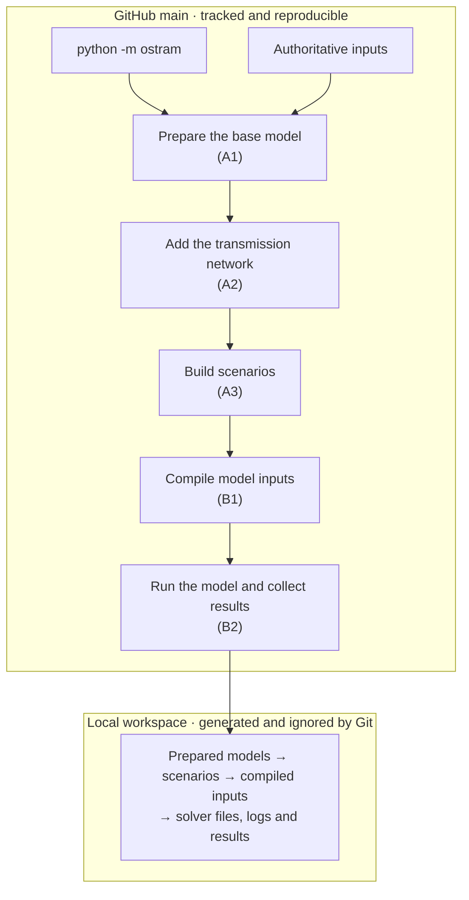

# Pipeline



GitHub `main` contains the maintained, reproducible source and authoritative
inputs. Generated inputs, solver files, logs, and results belong in the ignored
local workspace.

Run it with:

```powershell
python -m ostram run [options]
```

## Run terminal and detailed log

An interactive terminal shows a compact live status on stderr for all five
stages, including the active scenario where available, elapsed time, recent
status, and completed, failed, or skipped state. Redirected output uses stable
append-only status lines without cursor-control sequences. `--verbose` disables
the moving display and streams complete child stdout/stderr plus tokenized
command and working-directory diagnostics.

Every actual run writes a UTF-8 log to:

```text
<workspace>/logs/<run-id>/run.log
```

The log records run and stage timing, selected scenarios, child commands and
working directories, complete child output, child exit codes, interruptions or
exceptions, the final outcome, and the final process exit code. Help, malformed
arguments, imports, and `inspect-resources` do not create a workspace or log.
Terminal text safely degrades when the active stream encoding cannot represent
a path or character; the detailed log retains the original Unicode.

## Stages of one scenario run

`python -m ostram run --scenarios <S>` runs the steps below for the scenario
`<S>`. The example names are for the derived scenario `B_Opt_TxCap150`,
whose parent is `B_Optimised_VRE`. Paths without a tracked folder in front
are under the workspace. Terms are in the [glossary](glossary.md).

| Step | Command or module | Reads | Writes |
|---|---|---|---|
| Start | `python -m ostram run --skip-pull --scenarios B_Opt_TxCap150` | `config/setups/registry.json`, the scenario registry in `config/setups/south_asia.yaml`, `environment.yaml` | `logs/<run-id>/run.log` |
| Environment | `conda env list`; `conda env create` when the named environment is missing; one check per dependency | `environment.yaml` | the conda environment, when it is missing |
| DVC | `dvc init` and `dvc pull`; skipped with `--skip-pull` | `dvc.yaml`, `.dvc/config` | `.dvc/` |
| A1 | `python -B -m ostram.pipeline.preparation.base_inputs`, from `preparation/` | `inputs/osemosys_global/*.csv`, `config/preparation/Config_country_codes.yaml`, `config/preparation/Config_region_consolidation.yaml`, `inputs/preparation/secondary_technologies/Tech_Country_Matrix.xlsx`, the six templates in `inputs/preparation/workbook_templates/`, `config/compilation/Config_MOMF_T1_A.yaml` | `preparation/og_csvs_inputs/`, `preparation/extra_inputs/`, `preparation/A1_Outputs/A1_Outputs_<root>/` for all four roots, a runtime copy of the compilation configuration |
| A2 | `python -B -m ostram.pipeline.preparation.transmission`, from `preparation/` | `config/preparation/Config_country_codes.yaml` and the A-O workbooks of each root | the A-O workbooks in place, and `preparation/A1_Outputs/_post_a2_snapshot_<root>/` |
| A3 | `python -B -m ostram.pipeline.scenarios.materializer --scenarios B_Opt_TxCap150`, from `scenarios/` | the scenario registry, then the files in the A3 table below | `A1_Outputs_B_Optimised_VRE/`, `A1_Outputs_B_Opt_TxCap150/` and `_scenario_materialization.json` under `preparation/A1_Outputs/` |
| B1 | `python -B -m ostram.pipeline.compilation.runner --scenarios B_Opt_TxCap150`, from `compilation/`; it runs `python -B -m ostram.pipeline.compilation.compiler` once per scenario | the four A-O workbooks of the scenario, `preparation/extra_inputs/`, `preparation/og_csvs_inputs/EMISSION.csv`, the runtime compilation configuration | the completed workbooks in `A1_Outputs_B_Opt_TxCap150/`, `compilation/A2_Structure_Lists.xlsx`, `compilation/A2_Output_Params/B_Opt_TxCap150/*.csv` |
| B2 | `python -B -m ostram.pipeline.execution.runner --scenarios B_Opt_TxCap150`, from `execution/`, with `--compile-only` when `run` has it | `config/execution/Config_MOMF_T1_AB.yaml`, or `execution/Config_MOMF_T1_AB.yaml` when that copy exists; the runtime compilation configuration; `ostram/resources/compilation/conversion_format.yaml` and `templates/*.csv`; `config/setups/south_asia.yaml` for the gross import policy and the historical trade roots; `model/osemosys_fast_preprocessed.txt`; `inputs/execution/firm_capacity_fallbacks_by_cr.xlsx` | the files in the B2 table below |

A1 and A2 run only when a required root has no post-A2 snapshot. They
prepare all four roots at once.

### A3 for one root and one derived scenario

For the parent root the materializer runs
`python -B -m ostram.pipeline.scenarios.transform --scenario B_Optimised_VRE --soasia inputs/scenarios/OSTRAM_Scenario_Inputs.xlsx`
in a working folder `scenarios/_run_<stamp>/`. The modules are in
`ostram/pipeline/scenarios/transformations/` unless stated.

| A3 step | Modules | Reads | Writes |
|---|---|---|---|
| Working folder | `transform` | `inputs/scenarios/OSTRAM_Timeslice_Inputs.xlsx`, `config/scenarios/technology_types.csv`, the compilation configuration, the root's rule YAMLs | copies of all four in the working folder; the taxonomy is copied as `TECH_TYPES.csv` |
| Stage 0 | `scenario_workbooks` | `inputs/scenarios/OSTRAM_Scenario_Inputs.xlsx` | `_materialized_<root>.xlsx`, the root's rows merged over the `BAU` rows |
| Stage 1 | `merge_timeslices`, `extract_ao_extensions`, `ao_extension_decisions`, `update_ao_from_extensions`, `apply_manual_fixes`, `propagate_timeslice_fabric` | the merged workbook, the timeslice workbook, the post-A2 A-O workbooks | `SOASIA_OSeMOSYS_WV.xlsx`, `OSTRAM_AO_Extensions.xlsx`, the aligned A-O workbooks |
| Stage 1b | `insert_reserve_margin`, `add_max_capacity_investment_rule --fill-zeros`, `fix_elc_pmode_revert`, `pre_solver_validation` | the parameter workbook | the parameter workbook; the validation is report-only under `validation_no_mutation` |
| Stage 2 | `add_ao_c2a`, `fix_pwrpet_clear` | `TECH_TYPES.csv` | `A-O_Parametrization_c2a_patched.xlsx` |
| Stage 3 | `fix_trn_residuals`, `clear_stale_unbinding_caps`, `cap_trn_to_residual` | the interconnector data of the scenario workbook | the `_FIXED`, `_POST_CAP_RESET` and `_POST_TRN_CAP` workbooks |
| Stage 4 | `transform` | the Control sheet | `stage5/` with the four A-O workbooks; `A_Calibrated_BAU` inherits the restrictions of `BAU` |
| Stage 5 | the root's rule chain in `ostram/pipeline/scenarios/rules/` | `config/scenarios/<root>/*.yaml` | the A-O workbooks in `stage5/` |
| Shared rules | `apply_interconnector_costs`, `apply_internal_transmission`, `apply_internal_tx_losses` in `rules/`, then `apply_base_year_pin` for `A_Calibrated_BAU`, `B_Optimised_VRE` and `C_Target_VRE`, then the residual part of `apply_internal_transmission` for every root | the merged workbook, `config/preparation/Config_country_codes.yaml`, `config/scenarios/rules/pwr_min_2023_2026_pin.csv` | the A-O workbooks in `stage5/` |
| Stage 6 | `sync_og_to_ts20`, then `transform` | `SOASIA_OSeMOSYS_WV.xlsx`, the change records of stage 5 | the timeslice sets and parameters in `preparation/og_csvs_inputs/`, `_scenario_run_state_<root>.xlsx`, the four A-O workbooks in `A1_Outputs_<root>/`; `BAU` also receives its transmission ceilings |
| Derived scenario | `ostram/pipeline/scenarios/scenario_edits.py` | `A1_Outputs_<parent>/`, `config/scenarios/<scenario>/scenario.yaml`, the shared VRE ceilings in `config/setups/south_asia.yaml`, the base-year pin table | `A1_Outputs_<scenario>/` with its edit log; the overlay for the two direction variants |

The [rules page](rules.md) lists the rule chain of each root and the
[scenario edits page](scenario-edits.md) describes the derived build.

### B2 for one scenario

| B2 step | Module | Reads | Writes |
|---|---|---|---|
| Normalise | `ostram.pipeline.execution.runner` | `compilation/A2_Output_Params/<S>/*.csv`, the package CSV templates | `execution/A2_Outputs_Params_otoole/<S>/*.csv` |
| Base-year build lock | `ostram.pipeline.execution.base_year_lock`, called by the runner | the normalised CSVs, `config/scenarios/technology_types.csv`, the model file | `TotalAnnualMaxCapacityInvestment.csv` and `TotalTechnologyAnnualActivityLowerLimit.csv` of `execution/A2_Outputs_Params_otoole/<S>/`, in place |
| Convert | otoole, driven by the runner | the normalised CSVs, `conversion_format.yaml`, the gross import policy in the scenario's file, the historical trade roots and the link import cap in `south_asia.yaml`, the model file | `execution/Executables/<S>_0/<S>_0.txt` |
| Preprocess | `ostram.pipeline.execution.preprocess` | the datafile | `Pre_processed_<S>_0.txt` |
| Adjustment 1 | `model_file_adjustments.days_in_day_type` | the preprocessed datafile | the same file, in place |
| Adjustment 2 | `model_file_adjustments.storage_delay` | the datafile and `model/osemosys_fast_preprocessed.txt` | `Pre_processed_<S>_0_StorageDelayN5.txt` and `osemosys_fast_preprocessed_storage_delay.txt` |
| Adjustment 3 | `model_file_adjustments.open_pwrbck_caps` | the datafile | `Pre_processed_<S>_0_StorageDelayN5_OpenBCK.txt` |
| Adjustment 4 | `model_file_adjustments.reserve_margin_repair_xlsx` | the datafile and `inputs/execution/firm_capacity_fallbacks_by_cr.xlsx` | `Pre_processed_<S>_0_StorageDelayN5_OpenBCK_RMCarefulXLSX.txt`, the solver datafile |
| Matrix | `glpsol -m <adjusted model> -d <solver datafile> --wlp <LP> --check` | the two files | the LP |
| Solve | CPLEX reads the LP and writes the solution | the LP | the solution file |
| Results | otoole, then the concatenation and the cost reconciliation | the solution | `Outputs/*.csv`, the combined CSVs and `*_cost_reconciliation.json` |

`--compile-only` stops after adjustment 4. The storage stripping and the
older reserve-margin repair are switched off in the tracked configuration.

### Configuration files by stage

| File | Stage |
|---|---|
| `config/setups/registry.json` | `run`, for the setup selection |
| `config/setups/south_asia.yaml` | `run`, A3, B2 |
| `config/scenarios/<scenario>/scenario.yaml` | A3, B2 |
| `environment.yaml` | `run` |
| `config/preparation/Config_country_codes.yaml` | A1, A2, A3 |
| `config/preparation/Config_region_consolidation.yaml` | A1 |
| `config/compilation/Config_MOMF_T1_A.yaml` | A1, A3, B1, B2 |
| `config/execution/Config_MOMF_T1_AB.yaml` | B2 |
| `config/scenarios/technology_types.csv` | A3, B2 |
| `config/scenarios/<root>/*.yaml` | A3 |
| `config/scenarios/rules/pwr_min_2023_2026_pin.csv` | A3, and B2 for the gas and oil allowance |
| `config/scenarios/<scenario>/set_interconnector_direction.yaml` | A3 |
| `ostram/resources/compilation/conversion_format.yaml` | B2 |
| `ostram/resources/compilation/templates/*.csv` | B2 |

## Prepare the base model (A1) and add the transmission network (A2)

A1 reads the maintained CSV authorities in `inputs/osemosys_global/`, the
preparation configuration in `config/preparation/`, and workbook assets in
`inputs/preparation/`. A2 adds the transmission content. Their mutable
products and post-A2 snapshots live under `<workspace>/preparation/`.

The full runner treats A1+A2 as a pair. If every selected root already has its
post-A2 snapshot, the pair is skipped; otherwise the root preparation is
rebuilt before A3.

## Build selected scenarios (A3)

The maintained authorities are:

- `inputs/scenarios/OSTRAM_Scenario_Inputs.xlsx`
- `inputs/scenarios/OSTRAM_Timeslice_Inputs.xlsx`
- `config/setups/south_asia.yaml::scenario_registry`
- scenario-specific rule YAML files in `config/scenarios/<scenario>/`

Each derived scenario of the `south_asia` setup has its own file, `config/scenarios/<scenario>/scenario.yaml`.

The registry declares four roots and the derived scenarios. A root is
transformed through the ordered workbook stages. A derived scenario begins
from its declared root output and then receives only its registered scenario edits and
optional direction overlay.

Focused root transformation uses:

```powershell
python -m ostram transform --scenario A_Calibrated_BAU
```

Temporary stage directories are created under `<workspace>/scenarios/` and are
removed unless `--keep-workdir` is set. Python implementation files are never
copied into those directories; subprocess stages execute installed package
modules with explicit workspace and project paths. Ephemeral Stage-3 workbook
names are deterministic inside the unique run directory. If a desired absolute
workbook path would reach 240 UTF-16 code units, the filename is compacted to
its final semantic stage plus a short digest; the `.xlsx` extension and the
actual returned path are preserved for downstream stages. A workspace parent
that cannot hold even the compact name fails before workbook transformation.

## Compile model inputs (B1)

B1 consumes the explicit trajectories already present in the current scenario
workbooks. Emissions and Storage remain required
extra inputs generated by A1 from maintained workbook templates.

B1 reads materialized scenario workbooks, copies the maintained compiler YAML
into `<workspace>/compilation/`, updates the selected scenario in that runtime
copy, and writes compiled parameter CSVs under
`<workspace>/compilation/A2_Output_Params/`.

```powershell
python -m ostram compile-inputs --scenarios A_Calibrated_BAU
python -m ostram compile-inputs --scenarios "A_Calibrated_BAU,B_Optimised_VRE"
```

The maintained `config/compilation/Config_MOMF_T1_A.yaml` is not mutated.

## Run the model and collect results (B2)

B2 reads:

- `config/execution/Config_MOMF_T1_AB.yaml`
- `model/osemosys_fast_preprocessed.txt`
- `ostram/resources/compilation/conversion_format.yaml`
- compiled scenario CSVs from the selected workspace

It writes preprocessed text, optional solver artifacts, and result tables only
under `<workspace>/execution/` (apart from the documented root datafile export
when enabled).

The solver-free boundary is:

```powershell
python -m ostram run --skip-pull --compile-only --scenarios A_Calibrated_BAU
```

This route stops before matrix creation, solver adapters, cleanup, and result
post-processing. A normal `python -m ostram run` follows the solver and policy
settings in the execution YAML.

### Result layout and concatenation

Each scenario owns its otoole result tables at
`<workspace>/execution/Executables/<scenario>_0/Outputs/`. The directory is
anchored to the scenario regardless of whether `outputs` is configured as a bare
name or an absolute workspace path, so a serial multi-scenario run keeps every
scenario's results instead of overwriting them.

`concat_otoole_csv` writes that scenario's own combined table and feeds cost
verification, including `TotalDiscountedCost.csv`.

`concat_scenarios_csv` writes the cross-scenario combined CSVs. It runs **once
per run invocation**, in the final post-processing stage, after the last
scenario of the selection. It processes one scenario at a time and appends
each sorted block to the `Inputs`, `Outputs` and `Combined_Inputs_Outputs`
files, so peak memory is bounded by the largest single scenario rather than
by the campaign (`ostram.pipeline.execution.scenario_concatenation`). Because
it rereads every scenario present in `Executables/`, its time still grows
with the number of scenarios already on disk — so, after completing A, pass
the remaining selection to one invocation:

```powershell
python -m ostram --workspace $workspace run --skip-pull --scenarios "B_Optimised_VRE,C_Target_VRE" --a-result-seed $aResult
```

Driving a campaign as one invocation per scenario instead makes B2 — and
therefore this concatenation — run once per scenario, which is quadratic in the
selection size. Split invocations only when a run genuinely needs a seam
between scenarios, and expect that cost.

## Scenario selection

`--scenarios` accepts a comma-separated exact selection. The registry validates
names, preserves canonical order, calculates required roots, and resolves
declared result dependencies. `C_Target_VRE` requires the A-result
seed boundary; no result is discovered through caller CWD.

### Support BAU

The `south_asia` setup rule is: **BAU permits existing transmission
plus already committed additions, with no discretionary expansion beyond those
commitments.** Existing `TotalAnnualMinCapacityInvestment` values for the 18
interconnector `TRN` technologies are interpreted as the commitments. Their
year is their commissioning year. No investment minimum is removed or changed.

For technology `t` and model year `y`, the final ceiling is:

```text
TotalAnnualMaxCapacity[t,y] = ResidualCapacity[t,y]
  + sum(TotalAnnualMinCapacityInvestment[t,v]
        for model years v where 0 <= y-v < OperationalLife[t])
```

This uses the model's vintage survival rule: a committed addition is unavailable
before commissioning and expires at the operational-life boundary. Residual
capacity keeps its existing year-by-year trajectory. With the unchanged annual
investment minima, the ceiling prevents discretionary additions.
The final ceiling rows use `Projection.Mode = User defined`: B1 deliberately
omits rows marked `EMPTY`, even when their year cells contain numbers.

The policy runs **only on the final `south_asia` `BAU` output**, after disposable
restriction-state export and delivery. Shared preparation, post-A2 snapshots,
and inherited Restrictions retain their existing values. The
training setup does not enable this policy. Validation remains enabled and
does not apply repairs. `support_bau_transmission.json` beside the final
parametrization workbook records all 504 technology/year ceilings and sources.

After the [installation](installation.md), run this from the clone in the
activated environment:

```powershell
$workspace = Join-Path (Resolve-Path '..').Path 'support-bau-workspace'
if (Test-Path -LiteralPath $workspace) { throw 'Choose a new empty workspace path' }
python -m ostram --setup south_asia --workspace $workspace run --skip-pull --scenarios BAU --verbose
if ($LASTEXITCODE -ne 0) { throw 'Support BAU preparation/compilation/solve/export failed' }
```

This performs A1, A2, A3, B1, B2, export and cost reconciliation from maintained
checkout inputs, without an A-result seed.
Support `BAU` is a separate case; it is neither `A_Calibrated_BAU` nor a member
of the 17-case portfolio. A full portfolio run still needs the A-first
sequence below.

### 17-scenario portfolio

The `south_asia` registry distinguishes support `BAU` from the 17 decision
scenarios. A1, A2, A3, B1 and B2
name stages; B1 does not mean `B_Optimised_VRE`.

Support BAU has its own [committed-transmission policy and execution command](#support-bau).
Selecting A applies its existing declared transformations and preserves BAU
restriction inheritance. The portfolio does not require a BAU solve.

Use an empty, local workspace and an editable installation of this checkout.
The runner's default selection includes support BAU, and its single A3 pass
does not solve A before materializing C. Select the decision cases explicitly
and complete A first, then the parents of the corridor scenarios,
`B_Optimised_VRE` and `A_Calibrated_BAU_Clipped`. These three invocations use
only maintained checkout inputs and the newly solved results of the same
workspace.

```powershell
$workspace = Join-Path (Resolve-Path '..').Path 'w'
if (Test-Path -LiteralPath $workspace) { throw 'Choose a new empty workspace path' }
python -m ostram --workspace $workspace run --skip-pull --scenarios A_Calibrated_BAU --verbose
if ($LASTEXITCODE -ne 0) { throw 'A preparation/compilation/solve/export failed' }

$aResult = Join-Path $workspace 'execution\Executables\A_Calibrated_BAU_0'
python -m ostram --workspace $workspace run --skip-pull --scenarios "B_Optimised_VRE,A_Calibrated_BAU_Clipped" --a-result-seed $aResult --verbose
if ($LASTEXITCODE -ne 0) { throw 'Parents of the corridor scenarios failed' }

$remaining = python -c "from ostram.pipeline.scenarios.registry import load_registry; r=load_registry(); assert len(r.decision_scenarios)==17; print(','.join(n for n in r.decision_scenarios if n not in ('A_Calibrated_BAU','B_Optimised_VRE','A_Calibrated_BAU_Clipped')))"
if ($LASTEXITCODE -ne 0) { throw 'Cannot resolve the scenario selection' }
python -m ostram --workspace $workspace run --skip-pull --scenarios $remaining --a-result-seed $aResult --verbose
if ($LASTEXITCODE -ne 0) { throw 'Remaining portfolio failed' }
```

If the environment has another name, pass that name with `--env-name` in
every `run` invocation. Confirm the solver status of A and the two parents and
feasibility before allowing dependent materialization. `--compile-only` cannot
create this result dependency. For a solver-free single-case preparation check,
use `run --skip-pull --compile-only --scenarios A_Calibrated_BAU` in another
workspace.

The normal B2 route exports each scenario's otoole tables and reconciles costs
in its concatenated output.

`config/execution/Config_MOMF_T1_AB.yaml` selects CPLEX numerical emphasis
for `B_Opt_TradeCap15` through `cplex_numerical_emphasis_scenarios`. B2 applies
these settings before optimization and prints the changed
CPLEX settings. The selection is local to that solve; other scenarios retain
their original commands. Always check the final solver status and certificate; a successful
process exit alone does not establish feasibility.

## Path and process guarantees

- Project and workspace selection follow CLI > environment > editable checkout.
- Every resource and runtime path is absolute after resolution.
- Resource inspection never creates the workspace.
- Production code has no `sys.path` manipulation or global `chdir`.
- Python subprocess stages use `python -B -m <package.module>`.
- Commands use token lists, never `shell=True`.
- Package resources are opened read-only from the installed package.

See [configuration](configuration.md) for parameter details.
